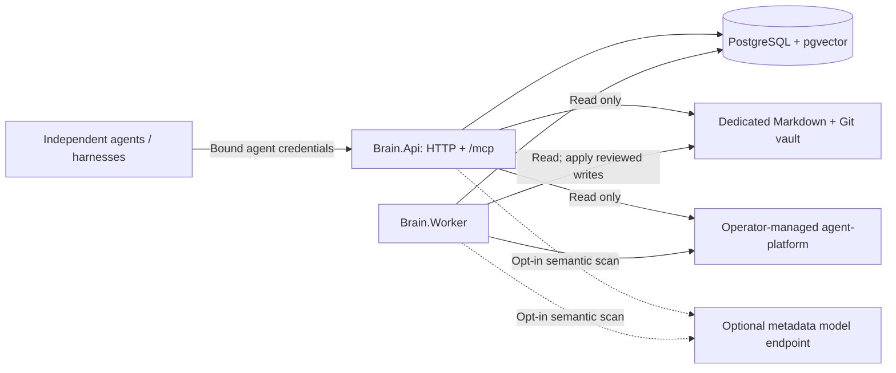

# Architecture

This is the current architecture of the Milestones 1-7 implementation. The
[foundation design](foundation.md) records the initial slice; the feature guides
describe individual modules in more detail. See [conventions](conventions.md)
for rules to preserve when extending the system.

## Purpose and boundaries

Homelab Brain is a self-hosted, shared information platform for independent AI
agents. It provides authenticated identities, deterministic permissions, scoped
memories, canonical knowledge retrieval, reviewed knowledge changes, and
permission-filtered skill/tool discovery.

Brain is not an agent runtime or an external tool executor. A skill supplies
instructions and a tool manifest describes an integration; neither causes Brain
to execute deployments, contact those systems, or retrieve secrets. Models can
suggest metadata, but cannot grant access or approve changes.

## Code organization

The solution is a modular .NET 10 application with two executable hosts and one
shared PostgreSQL database, not a set of independently owned microservices.

| Project | Responsibility | Direct project references |
| --- | --- | --- |
| `Brain.Domain` | Entities, identity context, permission constants, lifecycle enums and controlled exceptions | None; no package dependencies |
| `Brain.Application` | Request/result records, boundary interfaces, validation, use cases, chunking and change planning | Domain |
| `Brain.Infrastructure` | EF Core/PostgreSQL, pgvector, filesystem and Git adapters, YAML processing, optional metadata HTTP provider and shared registration | Application |
| `Brain.Mcp` | Typed MCP tools, strict argument binding and transport registration | Application |
| `Brain.Api` | HTTP endpoints, authentication, request-scoped identity, OpenAPI, error translation and API composition | Infrastructure, Mcp |
| `Brain.Worker` | Database readiness and scheduled background jobs, including the canonical writer | Infrastructure |

Dependencies point inward through Application to Domain. MCP has no persistence
or filesystem implementation. HTTP routes and MCP tools reuse the same
application services; they do not implement separate memory, proposal or
discovery logic. The shared composition root is
[`ServiceRegistration`](../src/Brain.Infrastructure/ServiceRegistration.cs).
Only the worker calls `AddKnowledgeWriter()` in normal hosting.

Other repository surfaces are `agent-platform` (sample registry), `sample-vault`
(development knowledge templates), `scripts` (initialization and smoke checks),
`docker` and `compose.yaml` (local deployment), and `tests` (unit/Git and
HTTP/MCP/PostgreSQL coverage). The running development vault is a separate Git
repository under ignored `.local`, not the application repository.

## Runtime topology

Compose starts PostgreSQL 17 with pgvector, API/worker containers, and the
React UI served by Nginx on loopback port 5173. Nginx proxies UI API requests to
the existing API process on the same browser origin. The API also publishes HTTP
on loopback port 5080; the database publishes on loopback port 55432. MCP uses
the existing API process and port. Both .NET hosts
mount the registry read-only. The API mounts the vault read-only, while the worker
mounts it read-write and owns canonical publication.

Before starting jobs, the worker waits for all EF migrations and pgvector, then
refreshes PostgreSQL type metadata. It does not apply migrations. The API can
apply migrations and development seeds when explicitly configured; production
migrations and initial identities are operator responsibilities.

Each job runs immediately and then on its configured interval, with a fresh
service scope per iteration. Failures are logged and retried; cancellation stops
the work.

| Job / configuration key | Default interval | Compose interval |
| --- | --- | --- |
| Expired memories / `Worker:CleanupIntervalSeconds` | 300 seconds | 30 seconds |
| Knowledge index / `Worker:KnowledgeScanIntervalSeconds` | 60 seconds | 30 seconds |
| Registry index / `Worker:RegistryScanIntervalSeconds` | 60 seconds | 30 seconds |
| Approved writes / `Worker:WriteQueueIntervalSeconds` | 10 seconds | 5 seconds |
| Metadata scan / `Worker:MetadataScanIntervalSeconds` | 300 seconds | 300 seconds |
| Retained traces / `ActivityTracing:CleanupIntervalSeconds` | 3600 seconds | 3600 seconds |

Knowledge and registry indexing require their source paths. Write processing
requires `Knowledge:WriterEnabled=true`; scheduled metadata scanning requires
`Metadata:Enabled=true`. Both flags default to false outside Compose. PostgreSQL
session advisory leases coordinate knowledge, registry and metadata scans and
the writer separately across processes. These leases do not lock canonical
files against a local editor.

## Data ownership and persistence

| Data | Authoritative source | PostgreSQL representation |
| --- | --- | --- |
| Agents, roles and grants | PostgreSQL | `agents`, `roles`, `permissions` and join tables |
| Agent memories | PostgreSQL | `memories` and model-labelled `memory_embeddings` |
| Canonical knowledge | Markdown files and their dedicated Git history | Rebuildable `knowledge_documents` metadata and `knowledge_chunks` text/vectors |
| Graph entities and relationships | Existing knowledge, registry and identity sources | No separate graph catalog; indexed document reference arrays support bounded reverse lookup |
| Skills, instructions and tool definitions | Operator-managed registry files | Rebuildable `registry_entries` metadata/vectors; not skill instruction bodies |
| Proposed changes and review/recovery state | PostgreSQL | `knowledge_write_proposals`, including durable prepared Git/file intent |
| Metadata inspection and deduplication state | PostgreSQL | `metadata_scan_states`, linked to generated proposals |
| Audit history | PostgreSQL | `audit_events` |
| Bounded trace history | PostgreSQL | `activity_traces`, `activity_events`; configurable retention, not audit data |

The database is not disposable just because search indexes are rebuildable:
memories, grants, reviews, recovery state and audits are durable application data.
Proposal content is proposed text, not a canonical document body.

[`BrainDbContext`](../src/Brain.Infrastructure/BrainDbContext.cs) owns explicit
EF mappings, relationships, database checks and `vector(384)` columns. Checked-in
migrations live beside it. JSONB holds flexible metadata, while permissions,
ownership and lifecycle fields remain typed. Multi-record state changes and
their audit events are committed together; read-access telemetry can use
separate commits.

## Identity and request flow

Agent clients authenticate API requests using both `X-Agent-Id` and a bearer token
bound to that ID. Configuration contains distinct SHA-256 token digests, not raw
client tokens. Authentication checks the digest in constant time and resolves
the enabled agent plus its role/direct grants from PostgreSQL. Effective grants
are an exact, case-sensitive union with no wildcard or implicit administrator
bypass.

The UI additionally accepts a dedicated administrator bearer token with no
identity input. This opt-in credential has its own SHA-256 digest and maps
server-side to a configured existing identity (`Authentication:UiAdminAgentId`).
Current database grants and enabled state are re-resolved on every request;
there is no administrator bypass or second permission system. Existing agent
credentials still require the bound ID/token pair, and MCP rejects the UI token.
The browser retains its token only in page memory. This shared-token flow does
not provide personal human identities or SSO. See [the UI guide](ui.md).

Identity inspection reuses `IAgentDirectory`: agents, independent details,
roles and permission catalogs require `agents.read`; agent responses distinguish
direct grants from the effective role/direct union. The UI exposes only existing
`agents.admin` registration/full-access replacement operations with explicit
review and server-side validation/self-edit protection. Role definitions and
credentials remain operator-managed. Access replacement has no revision token;
coordinate concurrent operator edits rather than treating it as a merge. See
[identity contracts and boundaries](ui.md#agents-and-permissions).

HTTP supplies `RequestAgent.Context`; MCP consumes the same scoped context
through `ICurrentAgent`. Callers cannot choose ownership, roles or review state
through a memory/tool input. Operation checks and visibility rules remain active
regardless of transport. `/health/live` is the only anonymous endpoint; readiness,
OpenAPI and every MCP request require authentication.

MCP uses the official SDK's stateless Streamable HTTP transport at `/mcp`. It
exposes eight information/proposal tools, no approval or direct writer tool.
Requests with an `Origin` header are rejected. Detailed connection, tool and
error contracts are in [the MCP guide](mcp.md).

## Retrieval and indexing

**Memories.** Creation validates content, scores, expiry and sharing permission,
then persists the memory, embedding and audit atomically. Private visibility is
the default. Reads/searches apply owner, stored team or organization visibility
and expiry in SQL; administrator roles do not bypass privacy. Caller filters
only narrow that scope. Access counts and last-access times support telemetry,
not automatic promotion.

**Knowledge.** Reads return live canonical UTF-8 content, a raw-byte content hash
and an opaque path-bound `v1.<sha256>` revision token. Scanning chunks Markdown
with heading/line context, embeds it, rechecks the source revision, and replaces
one document's index atomically. Unchanged file/model/chunker combinations are
skipped. Pruning requires a complete directory enumeration. Search verifies
candidate revisions against live files and omits stale hits, so it may return
fewer results until indexing catches up.

**Registry.** List/get operations read current manifests and skill instructions.
Search uses matching indexed fingerprints and embedding identity. Every tool
requires all manifest grants; a skill also requires every tool dependency and
its grants. Filtering precedes ranking/limit. Registry refresh replaces the
bounded catalog atomically, preserving the previous index on failure. Search
rechecks live sources before returning results.

All vector searches use pgvector exact cosine ranking and matching
provider/model/dimension descriptors. The registered development provider uses
deterministic 384-dimensional token hashing, not a learned semantic model.
Changing model identity requires re-embedding; changing dimensions also requires
a schema migration.

`SearchService` powers both `POST /api/search` and `brain_search`. It queries only
granted modules and returns separate knowledge, memory, skill and tool arrays;
there is no global score normalization. Limits apply per source, and capability
results include required tools even beyond the tool limit. Known unavailable or
invalid optional sources are reported in `failures`; unexpected errors propagate.
Calls run sequentially because the services share a scoped `DbContext`.

See [knowledge](knowledge.md) and [skills/tools](skills-and-tools.md) for indexing,
freshness, schema and permission details.

**Graph exploration.** `GraphService` composes bounded global/search/detail and
depth-limited neighborhood queries through `IGraphSource`. The adapter filters
database candidates before limits, rechecks canonical document revisions and
uses live manifest/dependency authorization shared with registry discovery.
Documents, skills/tools and identities require their existing source grants;
roles/permission nodes require `agents.read`. Both endpoints must be visible
and loaded before an edge is returned. Source references and allowlisted scalar
metadata replace bodies or arbitrary source metadata in graph responses.

Only explicit document `graph_references` are added to the rebuildable knowledge
index. The existing scanner versions/replaces these with the document; a GIN
index supports reverse lookup. Dependencies and grants derive from their current
sources on each graph request, not a synchronized second database. The UI's
isolated Sigma/Graphology feature progressively loads up to 200 nodes/400 edges;
server neighborhood depth is capped at two hops. See [UI graph contracts](ui.md#knowledge-graph).
The document inspector can link authorized canonical source paths to an
operator-configured WebObsidian instance using its `/note/<path>` route.
This public UI build-time setting never comes from document metadata; no Brain
credential or body is forwarded. Brain does not synchronize or edit the external
vault. See [WebObsidian linking](ui.md#webobsidian-linking).
Semantic graph queries and live overlays are not implemented.

**Shared UI shell.** The React application uses the supplied PAV OS reference's
night/orange palette, locally licensed fonts, compact navigation and responsive
hairline-separated widgets. Dark is the default; the light-mode toggle remains.
The operations Dashboard reuses the existing bounded, permission-filtered
Sigma graph in its center column, with API-backed inventory/health and
review/activity rails. It adds no graph service, canonical data source or
reference-project integrations. The standalone graph remains available.

**PAV OS demo.** A separate lazy-loaded UI page uses D3.js with HTML Canvas
to explore six layouts of the fictional `ui/demo-vault` fixture. Raw Markdown
imports supply its files, creation dates and explicit relative links; there is
no second graph catalog or backend multi-vault support. Its 134 real files
separate owning area, document kind and visualization layer. Six real overview
documents are initialed area hubs, not synthetic folder records. Size-weighted
sectors, compact area clouds and overview focus/framing use those same records.
The 598 actual Markdown references remain distinct from 133 inferred, dashed
area-membership guides; only actual references contribute to link counts and
directional signals. Clickable capability-ring labels focus their existing
layer across areas without removing nodes; screen-space label hit-testing and
keyboard buttons share that client-side focus state. Named capability rings,
temporary node dragging, directed-reference signal trails, decorative particle
core, coherent ripples and eased 3D rotation are client-side visualization only,
not live activity or external execution. The normal map fills the center of
the reference three-column composition; native fullscreen fills the viewport.
File details remain dismissible rather than a reserved inspector column.
File selection is nullable, separate from the always-visible `AGENTS.md`
context. Repeated node clicks and background taps clear file/ring focus and
inspection without changing camera/placements; gesture movement and cancellation
do not clear selection.
Demo clock/inventory, skills and routine/context widgets use actual local time
or fixture files, not simulated integrations. The read-only boundary is unchanged.
The fixture is public
static build content, contains no private/live data, and is not mounted into the
API or worker. Existing authorization, canonical sources and writer workflows
are unchanged. See [the demo boundary and layouts](ui.md#pav-os-demo-dashboard).

## Reviewed canonical changes

Canonical writes cross PostgreSQL, Git and filesystem boundaries; there is no
single transaction covering all three.

1. An authenticated agent reads current knowledge and submits a revision-bound
   proposal (or requests creation of a missing document). Submission queues
   `pending` state and does not edit files.
2. A reviewer previews the exact result and approves/rejects using the proposal's
   current integer version. Approval changes database state only.
3. The worker acquires the writer lease, reloads proposer/reviewer access, checks
   the dedicated clean Git checkout and canonical revision, and prepares exact
   result bytes and a Git commit. It retains a recovery ref and persists
   `validating` state with the prepared intent.
4. The writer publishes with an expected-parent Git reference update, materializes
   only expected old/result bytes, and updates only the target Git index entry.
   It then records `applied` plus audit and clears the temporary recovery body.
5. Interrupted prepared operations resume the same intent rather than repeating
   an append. Unexpected file/history changes conflict; repository conditions
   such as a dirty checkout defer work. Search indexing catches up separately
   through the scanner.

Supported caller operations are `append`, `replace_section` and
`create_document`. There is no auto-approval, force-apply or automatic merge.
All writers for a vault must use the same Brain database. Pause the writer for
direct human filesystem/Git maintenance and resume with a clean checkout.
Recovery details and supported repository constraints are documented in
[safe knowledge writes](knowledge-writes.md).

## Metadata enrichment

`MetadataService` inspects frontmatter through the read-only vault interface.
It combines deterministic missing-field repairs with optional structured model
suggestions, validates a JSON patch and its rendered document, then stores scan
state, a pending proposal and generation audits atomically. Revision and policy
fingerprints prevent duplicate proposals for unchanged inspected sources.

Valid human fields, comments, unknown fields and Markdown body content are
preserved. Ambiguous YAML requires manual repair. Metadata proposals use the
same preview, explicit review and Git writer as ordinary changes; confidence is
never authorization. Generic HTTP/MCP proposal submission cannot create this
scanner-only operation.

Semantic enrichment is disabled by default, including in Compose. Enabling it
sends a bounded body excerpt and metadata context to an operator-selected
OpenAI-compatible endpoint. This provider is separate from `IEmbeddingProvider`;
it does not improve vector recall. See [metadata enrichment](metadata-enrichment.md)
for schema, provider and cache behavior.

## Operational constraints and limits

Application activity uses W3C `ActivitySource`/OpenTelemetry and an
`IActivityPublisher` boundary. Authenticated requests, search/discovery, skill
selection, MCP/tool adapters, native HTTP and worker jobs preserve trace/span
parentage. Sanitized PostgreSQL notifications bridge live worker/API events to
permission-filtered SSE; bounded retained summaries/events support inspection.
Visibility is partitioned by authenticated owner even when trace IDs are reused.
Retention and optional OTLP export are independent of live delivery. See
[activity tracing](activity-tracing.md) for contracts, limits and safety.

`ConnectionStrings:Brain` is required. `Knowledge:VaultPath` and
`Registry:RootPath` configure optional source modules; absent configuration
disables their jobs and returns controlled errors for their operations without
disabling memories. Configure both hosts against the same sources, database,
embedding identity and metadata policy.

Vault access rejects unsafe paths and linked files/directories, but assumes
trusted local operators rather than an OS sandbox against hostile filesystem
swaps. Knowledge currently has one shared vault and no per-document ACLs.
Multi-organization tenancy, remote Git synchronization, automatic memory
promotion and approximate vector indexing are not implemented.

Compose is a development environment, not a production security/deployment
profile. Production requires explicit identities/grants, external credential
configuration, TLS, restricted database access, reviewed migrations and backups
of both durable database state and canonical repositories. External secret
retrieval is not implemented; clients must not submit secret values. Use the
[README](../README.md) for setup and [verification](verification.md) for recorded
implementation evidence and reproduction guidance.
