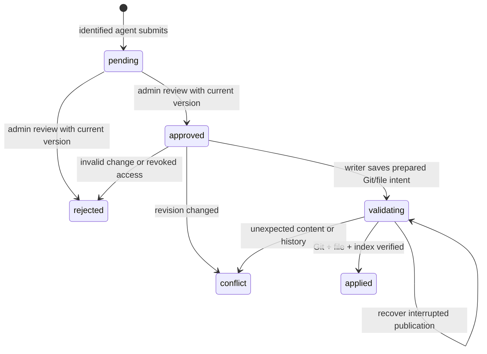

# Safe knowledge writes — Milestone 3

## Boundaries and schema

Agents can submit proposals and read review previews through the API. The API has no canonical writer registration or write endpoint and mounts the vault read-only. `Brain.Worker` registers the Git writer and processes approved proposals only when `Knowledge:WriterEnabled=true`. Indexing and memory cleanup remain separate jobs in the same worker host.

The `SafeKnowledgeWrites` migration adds `knowledge_write_proposals`: owner, path, base revision, operation, content, optional section, reason, status, version, reviewer/reason/timestamps, apply timestamp, last error, and the durable Git/file recovery fields. Status and operation values have database checks; version is an EF optimistic concurrency token. Status/creation and owner/creation indexes support queue and listing queries. Author identity is a foreign key; review identity is retained as historical metadata.

The filesystem/Git checkout stays canonical. The proposal body is an agent's proposed change. A temporary complete result body is stored in the prepared journal for crash recovery and cleared after successful application; it is never served as the canonical document.

## Lifecycle and permissions



Submission requires `knowledge.read` and `knowledge.propose`. Proposal ownership comes from authenticated identity. Agents can see their own proposals; an agent with `knowledge.admin` and `knowledge.read` can see/review all. Approval/rejection is restricted to pending proposals and requires the proposal's current integer `version`, so concurrent reviews cannot both succeed. Rejected proposals never reach the writer. There is no auto-approval, force-apply, direct edit or automatic conflict merge.

Before preparing a newly approved operation, the worker reloads the proposer and reviewer identities. Disabled/missing proposers or lost read/propose access, or a reviewer without administrative access, result in rejection. Once an authorized prepared intent is durable, retries finish that same operation; they do not start a fresh write or repeat an append. `validating` is a recovery state, not an LLM authorization decision.

Development seeding adds `knowledge.propose` to the agent role and administrator role. Existing development seeds are extended when migrations/startup seeding run. Production operators must provision the permission and grants explicitly.

## HTTP flow

Read a document first:

```http
GET /api/knowledge/document?path=Infrastructure/Proxmox/nacht-02.md
X-Agent-Id: codex
Authorization: Bearer <codex-token>
```

Submit a proposal with the returned revision token:

```json
{
  "path": "Infrastructure/Proxmox/nacht-02.md",
  "operation": "append",
  "revisionToken": "v1.<64 lowercase hex characters returned by read>",
  "content": "Observed: corosync.conf is missing during the cluster join attempt.",
  "reason": "Observed during troubleshooting; preserve the source observation."
}
```

`POST /api/knowledge/proposals` returns 201 with a pending proposal and `version`. It changes no canonical files or Git branch. A stale token at submission returns 409 without queuing a misleading proposal. The worker checks the version again later, so a valid submission does not guarantee application.

Reviewers use `GET /api/knowledge/proposals/{id}/preview` to inspect live `before` and proposed `after` content. `revisionMatches: false` returns a conflict reason and no fabricated merged result. Approve or reject through the generic endpoints:

```http
POST /api/knowledge/proposals/{id}/approve
X-Agent-Id: willem-de-jong
Authorization: Bearer <administrator-token>
Content-Type: application/json

{"version":0,"reason":"Verified the observation and reviewed the proposed text."}
```

Approval changes database state only. Poll `GET /api/knowledge/proposals/{id}` for `applied`, `conflict` or `rejected`; successful application records `gitCommit` and `appliedAt`. Errors/deferred repository conditions appear in `lastError` where available and worker logs. `GET /api/knowledge/proposals?status=pending&limit=50` lists up to 100 visible proposals.

An already reviewed or outdated review version returns 409. There is no editing or reopening of terminal proposals. Read the newest document and submit a fresh proposal after a conflict.

## Operations

| Operation | Revision and content rules |
| --- | --- |
| `append` | Requires an existing document and its current revision. Preserves original text and adds a line separator if needed before the proposed text. |
| `replace_section` | Requires current revision and `section`, an exact ATX heading hierarchy such as `Proxmox nacht-02 / Cluster recovery`. Replaces the section body and descendant subsections while preserving its heading and following sibling sections. Missing/duplicate section paths are rejected. Fenced code and closed frontmatter are not interpreted as headings. |
| `create_document` | Requires an absent/null revision token and a missing target path. The missing-document check is repeated before application; a competing creation becomes a conflict. Parent directories are created only by the writer. |

Each proposal's content is limited to 32,000 characters; reason/review reason to 2,000. Content whitespace is preserved; invalid Unicode and NUL are rejected. Append preserves existing bytes' UTF-8 BOM and newline style; section replacement normalizes replacement body newlines to the source style. The resulting file must fit `Knowledge:MaximumDocumentBytes`. No-op changes are rejected. All stale revisions conflict, including apparently mergeable appends: this MVP has no deterministic rebase/merge policy yet.

## Dedicated repository and writer configuration

The writer requires a dedicated, initialized Git checkout whose root is exactly `Knowledge:VaultPath`, with a physical `.git` directory, an initial commit and a checked-out named branch. Nested repositories, linked roots/components, worktree `.git` pointer files, detached HEAD, ignored new documents and non-regular/executable target modes are unsupported. Existing Markdown targets must be tracked. Raw UTF-8 file bytes must be represented directly in Git: custom filters, working-tree encoding and text/eol attributes on target files defer processing; `*.md -text` is supported. Commands override `core.autocrlf=false` so canonical CRLF/BOM bytes are stable.

Normal preparation requires a clean Git checkout/index, including untracked files. The target's actual raw bytes are also compared to the parent Git blob, so index flags cannot hide an uncommitted target edit. Dirty checkouts defer approved proposals instead of committing or discarding unrelated work. Once an operator resolves/commits those changes, the next worker attempt rechecks the current document revision. Do not point the writer at the application checkout or an arbitrary parent repository.

Local setup:

```powershell
./scripts/Initialize-DevelopmentVault.ps1
docker compose up --build -d
```

The initializer creates `.local/vault` from sample documents and makes its initial Git commit; an existing initialized vault is preserved. Compose mounts that repository at `/vault:ro` in the API and `/vault:rw` in the worker. The image includes Git. `BRAIN_VAULT_PATH` changes the host mount; `BRAIN_WRITER_UID`/`BRAIN_WRITER_GID` choose the worker user/group for bind-mount ownership on Linux. Give the API read access and the worker write access to files and Git metadata. Outside Compose, enable the writer explicitly with `Knowledge__WriterEnabled=true`; `Worker__WriteQueueIntervalSeconds` defaults to 10 (Compose 5).

All writers for one vault must share one Brain database. A PostgreSQL session advisory lease permits one active writer across worker instances; it is distinct from the scanner lease. No OS lock on canonical Markdown is used. Git itself uses its normal internal metadata locks plus expected-old-value reference updates.

**Concurrency contract:** Brain Writer owns canonical writes while enabled. Agents and WebObsidian integrations must use proposals rather than write the mounted directory. Pause the writer before direct human filesystem/Git maintenance, then resume with a clean checkout. Revision checks detect changes since reading/preparation, but portable filesystem APIs cannot provide an atomic compare-and-replace against an uncooperative local process changing files between the final hash check and rename. Link checks also assume trusted local vault operators rather than a hostile process swapping filesystem objects continuously.

## Durable publication and recovery

PostgreSQL, Git and the filesystem cannot commit one atomic transaction. The writer handles their boundary explicitly:

1. Read current canonical bytes and require the proposal's base revision (or document absence).
2. Build the exact result and create a Git blob/tree/commit using an alternate temporary index. The normal Git index and canonical files are untouched. Retain the prepared commit at `refs/brain/proposals/{proposal-id-without-dashes}` so Git garbage collection cannot remove recovery data.
3. Save `validating` plus parent branch/commit, result commit/blob, base/result hashes, result text and BOM flag to PostgreSQL with a prepared audit event.
4. Recheck branch, target bytes and staged target. Publish the prepared commit using `git update-ref` with the expected parent commit. A moved branch conflicts without writing the file.
5. Materialize the file only if it still has the expected base bytes (or remains absent). Write/flush a temporary file in the target directory, check again, then rename. New documents use a no-overwrite move. The temporary path is deterministic per proposal so its interrupted write can be replaced on recovery.
6. Update only the target entry in the normal Git index; verify result bytes. Persist `applied` and its audit event, clearing the journal body.

If the process stops after branch publication but before the file/index update, the next attempt recognizes the same prepared commit and expected old/result bytes and finishes materialization. If the file/commit completed but the final database save failed, the queued `validating` row is replayed without repeating the append or creating another commit. Prepared recovery rows are processed before new approved work.

If unexpected content, branch or staged target changes appear, recovery stops in conflict and never resets files/history to conceal them. A conflict after branch publication can leave the prepared commit visible in Git while the filesystem/index requires operator reconciliation; the proposal retains its commit and journal details. Inspect the recorded parent/result commit and actual files, resolve deliberately, and submit a fresh proposal as needed. The writer never force-resets or automatically rolls back newer work. Storage/Git failures leave recoverable queued state; Git diagnostics stay in operational logs rather than proposal content.

Prepared refs are retained for audit/recovery, including when preparation was interrupted before a database update. Retention/export is operator work. No fetch, pull, push, credential retrieval or remote Git synchronization is implemented. Each successfully applied proposal has one local commit identifying the proposer and proposal ID.

The Git runner uses argument lists and standard input, never a shell. Proposal text and paths are not command strings. Repository hooks are disabled, commit signing is disabled for this local writer identity, inherited `GIT_*` overrides are removed, and target paths are literal Git pathspecs. Path validation also rejects Windows device names, case aliases on Windows and nonportable filename lengths.

## Audit and verification

Events include `brain.knowledge.proposed`, `.approved`, `.rejected`, `.prepared`, `.applied`, `.conflict`, `.deferred`, plus authorization denial events. Row changes and their corresponding events are saved together. Audit identifies resources and agents without copying canonical/proposed bodies into events.

The unit suite uses real temporary Git repositories to verify literal filenames, staged-change preservation, BOM/CRLF, hook suppression, replay and revision conflicts. HTTP/PostgreSQL/Git integration tests cover the complete lifecycle, review races, author revocation, proposal visibility, competing edits/creations, writer exclusion and simulated database failure after Git success. The hosted smoke test runs API and worker as separate processes against a temporary database and vault.

The writer module does not execute skills/tools. [Milestone 4](skills-and-tools.md) provides registry discovery. [Milestone 5 MCP](mcp.md) can submit pending proposals through the same application service; it cannot approve or write canonical knowledge. [Milestone 6](metadata-enrichment.md) adds scanner-generated `metadata_enrichment` proposals containing validated JSON patches; the writer updates only frontmatter after explicit review and matching revisions.
